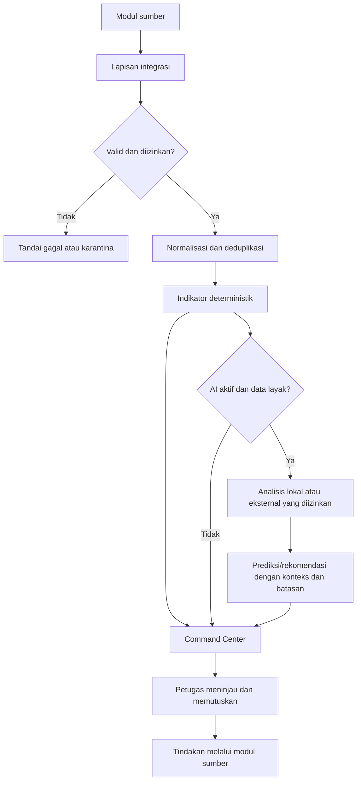

# Rancangan teknis: Hospital Operating System — Command Center rumah sakit

**ID:** STD-0036  
**Tahap:** Desain teknis  
**Status:** Rancangan untuk ditinjau manusia  
**Risiko usulan:** Tinggi

## Ringkasan

Command Center diusulkan sebagai fitur dalam modul Dashboard. Lapisan integrasi menerima kejadian operasional yang diizinkan dari modul sumber, memvalidasi, menormalkan, dan mendeduplikasinya, lalu menyediakan indikator agregat beserta sumber, waktu pembaruan, dan status kesegarannya. WebSocket atau mekanisme setara dapat memperbarui tampilan setelah autentikasi, izin, dan cakupan fasilitas/unit ditetapkan. Bila kanal tersebut belum tersedia, fase awal dapat menggunakan polling.

AI merupakan tahap lanjutan dan terpisah dari perhitungan indikator deterministik. AI hanya menyajikan perkiraan, temuan hambatan, ringkasan, jawaban, atau rekomendasi untuk ditinjau petugas. AI tidak mengubah catatan sumber atau menjalankan keputusan klinis maupun operasional. Data pasien teridentifikasi tidak boleh dikirim ke layanan AI eksternal; pemrosesan lokal seperti Ollama adalah opsi yang harus divalidasi.

Dokumen ini adalah rancangan untuk implementasi bertahap, bukan bukti bahwa sumber telah terhubung, infrastruktur tersedia, atau penggunaan AI telah disetujui.

## Temuan repo

- `frontend-service/src/stores/dashboard.ts` dan `frontend-service/src/router/index.ts` menjadi titik awal penelusuran dashboard, store, dan rute.
- Store sumber yang relevan mencakup `admisi/monitoringKamar.ts`, `igd/laporan.ts`, `penunjang/kamarOperasi.ts`, `penunjang/ambulans.ts`, `penunjang/sarpras.ts`, dan `penunjang/laundry.ts`.
- Katalog dan roadmap mencatat modul terkait, tetapi tidak membuktikan adanya event bus bersama, integrasi lintas modul real-time, WebSocket Command Center, atau AI operasional.
- Infrastruktur dan jalur API layanan perlu diinventarisasi sebelum memilih lokasi integrasi agar tidak menduplikasi kemampuan yang sudah ada.

## Arsitektur usulan

Lapisan kejadian mencatat ID kejadian, sumber, jenis, versi skema, waktu kejadian, waktu penerimaan, status validasi, dan kunci idempotensi. Data dibatasi pada kebutuhan agregasi; identitas pasien tidak menjadi bagian payload agregat. Kejadian duplikat tidak boleh menggandakan indikator, sedangkan kejadian terlambat, tidak valid, atau tertunda harus terlihat sebagai masalah mutu/kesegaran.

## Cakupan dan kontrak API usulan

Fase pertama menampilkan indikator dari sumber yang benar-benar terhubung: ketersediaan bed per ruangan, alur IGD ke rawat inap, antrean/waktu tunggu, status kamar operasi dan ambulans, alat kritis, serta stok kritis. Indikator yang sumbernya belum tersedia ditandai belum tersedia, tertunda, kedaluwarsa, atau tidak lengkap; data lama tidak boleh disebut real-time.

Endpoint berikut merupakan usulan dan belum tersedia sebagai kontrak implementasi. Mengikuti konvensi repo (`/api/v3/<layanan>/…`), titik awalnya laporan-service yang sudah memegang endpoint dashboard (`laporan-service/src/routes/dashboard-routes.js`); lokasi final ditetapkan saat desain implementasi fase 1.

| Metode dan jalur | Tujuan |
|---|---|
| `GET /api/v3/laporan/command-center/ringkasan` | Ringkasan indikator, status data, dan sumber. |
| `GET /api/v3/laporan/command-center/indikator` | Indikator terpilih beserta definisi, sumber, waktu pembaruan, dan kesegaran. |
| `GET /api/v3/laporan/command-center/peringatan` | Peringatan berbasis ambang yang telah ditetapkan. |
| `POST /api/v3/laporan/command-center/peringatan/:id/tinjauan` | Mencatat tinjauan, eskalasi, atau pengabaian oleh petugas berwenang. |
| `GET /api/v3/laporan/command-center/status-sumber` | Ketersediaan dan waktu pembaruan sumber. |
| Kanal real-time | WebSocket atau mekanisme setara, hanya setelah autentikasi dan cakupan akses divalidasi. |

Respons HTTP mengikuti bentuk `{message,payload}`. Autentikasi dan izin diperiksa di backend untuk setiap permintaan. `faskes_uuid` selalu berasal dari token, tidak dari body atau parameter; cakupan unit berasal dari izin/kebijakan sistem. Akses Command Center tidak memperluas izin detail pada modul sumber. Tindakan transaksi tetap melalui modul sumber.

Ingest kejadian internal bukan API publik yang telah ditetapkan. Desain implementasi harus menentukan autentikasi antarlayanan, pemantauan, pengiriman ulang, validasi, dan deduplikasi. AI tidak termasuk API fase pertama.

## Data usulan

Belum ada perubahan tabel/kolom yang ditetapkan. Setelah inventarisasi skema sumber dan pemilihan lokasi layanan, area data yang perlu dirancang meliputi:

| Area | Data minimum |
|---|---|
| Kejadian | ID, `faskes_uuid`, kunci kejadian, sumber, jenis, versi skema, waktu kejadian/penerimaan, payload minimum, status validasi, `created_at`, `deleted_at`. |
| Status sumber | ID, `faskes_uuid`, sumber, unit opsional, status, waktu penerimaan terakhir, rincian teknis minimum, waktu buat/ubah, `deleted_at`. |
| Ambang | ID, `faskes_uuid`, kode indikator, unit opsional, konfigurasi ambang, status aktif, pembuat, waktu buat/ubah, `deleted_at`. |
| Tinjauan | ID, `faskes_uuid`, kunci peringatan, status, catatan nonpasien, peninjau, waktu tinjau, waktu buat/ubah, `deleted_at`. |

ID menggunakan UUIDv7, waktu menggunakan epoch detik, tabel berfasilitas memiliki `faskes_uuid`, dan kueri selalu dibatasi dengan nilai fasilitas dari token. Kendala unik mendukung idempotensi. Tabel Command Center bukan catatan transaksi pasien dan tidak menggantikan data sumber. Jika migrasi dibutuhkan, buat migrasi baru yang idempoten tanpa mengubah migrasi lama.

## Katalog, izin, dan frontend

Rancangan memilih fitur **Command Center** di modul Dashboard, bukan modul baru. Implementasi fitur wajib mengikuti `docs/MANAJEMEN-MODUL.md`: ubah `database/data/katalog-modul.json`, buat migrasi sinkronisasi katalog melalui `sinkronKatalog`, daftarkan izin baca dan aksi yang diperlukan pada `auth-service/src/helpers/permission-list.js` beserta migrasi izin, tambahkan rute dan menu dengan pemeriksaan izin, lalu jalankan `npm run docs:katalog`.

Izin awal hanya untuk ringkasan, indikator, status sumber, dan peringatan dalam cakupan pengguna. Tinjauan/eskalasi memakai izin aksi tersendiri. Halaman menampilkan kartu indikator, alur IGD ke rawat inap, antrean, status sumber, dan peringatan; menampilkan waktu pembaruan; serta tidak hanya mengandalkan warna. Polling menjadi pilihan bila WebSocket belum tersedia.

## Keamanan, privasi, dan tata kelola AI

- Terapkan autentikasi, otorisasi per permintaan/koneksi, pembatasan fasilitas dari token, dan pembatasan unit dari kebijakan sistem.
- Gunakan data agregat/minimum. Detail hanya ditampilkan jika diperlukan dan diizinkan melalui izin modul sumber.
- Blokir pengiriman ke AI eksternal bila data pasien teridentifikasi terdeteksi. Gunakan lingkungan lokal yang disetujui bila data tidak boleh keluar rumah sakit.
- Pisahkan indikator/ambang deterministik dari keluaran model. Catat versi model, waktu, sumber yang diizinkan, cakupan, keterbatasan, dan tinjauan sesuai kebijakan retensi.
- Petugas berwenang menilai dan menjalankan tindakan melalui modul sumber. AI tidak mendiagnosis, menentukan prioritas klinis, menyetujui pemulangan, memindahkan pasien, menetapkan bed, atau mengeksekusi tindakan.
- Jika sumber atau model tidak tersedia, tandai data tertunda/kedaluwarsa atau AI tidak tersedia; jangan menyajikan data lama sebagai keadaan terkini.
- Ambang, definisi indikator, pemilik tindak lanjut, retensi, kriteria mutu model, dan target keberhasilan ditetapkan rumah sakit.

## Peta jalan

| Fase | Cakupan | Gerbang |
|---|---|---|
| 1 — Dasbor operasional | Integrasi sumber prioritas, indikator deterministik, kesegaran/status sumber, kontrol akses, dan peringatan ambang. | Rekonsiliasi dengan modul sumber; definisi indikator, pemilik, cakupan, ambang, dan kesegaran disepakati. |
| 2 — Peringatan dan prediksi | Perluasan aturan, perkiraan kedatangan IGD/kebutuhan bed, serta deteksi hambatan jika data layak. | Validasi historis, galat/ketidakpastian, pemantauan mutu, dan kriteria penghentian hasil. |
| 3 — Rekomendasi dan dukungan alur kerja | Ringkasan, tanya-jawab terbatas, rekomendasi kontekstual, dan persiapan tindakan untuk ditinjau. | Tata kelola, audit, matriks kewenangan, persetujuan manusia, pembatalan, dan evaluasi dampak. |

Indikator keberhasilan yang perlu didefinisikan rumah sakit: waktu tunggu IGD, waktu tunggu kamar, BOR, kesegaran indikator, ketersediaan sumber, ketepatan peringatan/prediksi, tindak lanjut rekomendasi, dan kelengkapan audit.

## Rencana verifikasi implementasi

- API/izin: pengguna tanpa izin ditolak; fasilitas dari request tidak mengubah cakupan token; cakupan unit diterapkan.
- Integrasi: pengiriman ulang tidak menggandakan indikator; kejadian terlambat/invalid ditandai; sumber kedaluwarsa tampak pada dasbor.
- Peringatan: ambang terkonfigurasi menghasilkan peringatan; tanpa ambang tidak menghasilkan peringatan; tinjauan memerlukan izin aksi dan audit server.
- Privasi AI: fixture sintetis dengan penanda identitas diblokir dari konektor eksternal; tidak ada identitas pada log.
- Kegagalan: gangguan sumber/AI/kanal terlihat dan tidak menyembunyikan keterbatasan; fungsi deterministik yang tersedia tetap berjalan.
- Frontend: rute/menu diperiksa izinnya; waktu pembaruan dan status sumber terlihat; layar besar mudah dibaca.
- Migrasi/katalog: migrasi idempoten, sinkronisasi sesuai katalog, dan `npm run docs:katalog` bersih.

Semua fixture harus sintetis. Tidak menggunakan basis data produksi untuk verifikasi migrasi.

## Keputusan yang masih diperlukan

1. Sumber prioritas fase pertama dan urutan perluasan.
2. Event bus, WebSocket, atau mekanisme setara yang tersedia serta pemilik operasionalnya.
3. Data yang boleh dipakai analitik/AI, batas pemrosesan lokal/eksternal, dan retensi.
4. Pemilik definisi indikator, ambang, target, cakupan unit, dan eskalasi.
5. Batas kesegaran/ketersediaan dan kriteria mutu minimum prediksi.
6. Izin agregat lintas unit, izin tinjauan/eskalasi, dan rincian audit yang diperbolehkan.
7. Batas otomasi fase ketiga; eksekusi mandiri tidak termasuk dalam rancangan ini.
